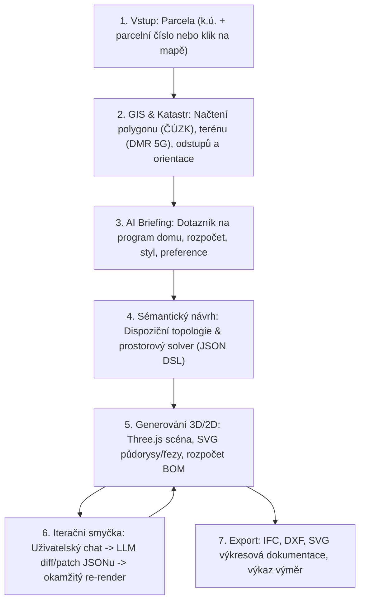

# Technický a architektonický plán: Obecný generativní nástroj pro návrh rodinných domů (AI Architekt)

Tento dokument specifikuje architekturu, integrace, datové modely a postup transformace stávajícího 3D/CAD jádra domu na univerzální platformu pro generativní a konverzační návrh rodinných domů na reálných parcelách v ČR.

---

## 1. Vize a uživatelský tok (User Flow)



---

## 2. Architektonické pilíře systému

### Pilíř 1: Katastr nemovitostí & GIS (ČÚZK, RÚIAN, Terén)
* **Získání hranic parcely:**
  * **ČÚZK WFS / Katastr API:** Dotaz na základě kódu katastrálního území a čísla parcely vrátí polygon v souřadnicovém systému S-JTSK (EPSG:5514).
  * Převod souřadnic do lokálního metrického kartézského systému se středem v těžišti parcely.
* **Výškopis a 3D terén (DMR 5G):**
  * Využití otevřených výškopisných dat ČÚZK (Digitální model reliéfu 5. generace) pro vytvoření sklonité sítě terénu (TIN mesh v Three.js).
* **Zastavitelné jádro & Stavební pravidla:**
  * Automatické odsazení 2 m od hranic sousedních pozemků (stavební zákon).
  * Nastavení uliční čáry (např. 3–5 m od komunikace).
  * Vymezení optimálního oslunění: orientace zahrady a obytných prostor na J / JZ, technické a obslužné zázemí na S / SV.

### Pilíř 2: Sémantický doménový model domu (JSON DSL)
Oddělení vizualizačního a výpočetního jádra od dat. LLM nemanipuluje s 3D vertexy ani Three.js kódem, ale operuje nad striktním JSON schématem:

```json
{
  "site": {
    "parcelId": "123/4",
    "kuCode": 768120,
    "boundary": [[0, 0], [25.4, 0], [24.8, 38.2], [0, 36.5]],
    "setback": 2.0,
    "buildablePolygon": [...]
  },
  "building": {
    "footprint": { "origin": [8.0, 10.0], "rotationDeg": 12 },
    "floors": 2,
    "structure": { "wallExteriorThick": 0.45, "wallInteriorThick": 0.15, "clearHeight": 2.75 },
    "roof": { "type": "gabled", "pitchDeg": 35, "overhang": 0.6 },
    "rooms": [
      {
        "id": "1.01",
        "name": "Zádveří",
        "floor": 1,
        "targetArea": 6.5,
        "side": "N",
        "adjacentTo": ["1.02", "1.03"]
      },
      {
        "id": "1.04",
        "name": "Obývací pokoj + KK",
        "floor": 1,
        "targetArea": 48.0,
        "side": "SW",
        "adjacentTo": ["1.03", "terrace"]
      }
    ],
    "openings": [
      { "id": "w1", "type": "window", "roomId": "1.04", "wall": "south", "width": 3.0, "height": 2.3 }
    ]
  }
}
```

### Pilíř 3: LLM Architekt & Dispoziční generátor (Hybrid AI)
* **Kroky generování:**
  1. **Konverzační dotazník (Briefing):**
     * Počet osob, typologie (bungalov vs. patrový dům), parkování (garáž / stání), sklon střechy, rozpočtový limit.
  2. **Topologický graf místností:**
     * LLM vygeneruje sémantický graf sousedností (propojení zádveří $\rightarrow$ chodba $\rightarrow$ obývák $\rightarrow$ terasa atd.).
  3. **Deterministický prostorový solver (Floorplan Solver):**
     * Algoritmus (např. řezání obdélníků / squarified treemap / constraint satisfaction) přeloží topologii a cílové metráže do exaktních pravoúhlých buněk s reálnými tloušťkami zdí.
  4. **Rozmístění otvorů a sanity/nábytku:**
     * Aplikace ergonomických pravidel (prosvětlení obytných místností min. 1/10 podlahové plochy, standardní moduly kuchyní, koupelen a postelí).

### Pilíř 4: Iterační smyčka a konverzační úpravy
* Uživatel zadává přirozeným jazykem změny:
  * *„Zvětši dětský pokoj na úkor ložnice.“*
  * *„Přidej do přízemí spíž přístupnou z kuchyně.“*
  * *„Změň sedlovou střechu na pultovou a sniž rozpočet o 10 %.“*
* LLM obdrží aktuální JSON stav a uživatelský pokyn $\rightarrow$ vygeneruje JSON patch (diff).
* Aplikace provede validaci, aplikuje patch a okamžitě regeneruje:
  * **3D model** na pozemku,
  * **2D CAD výkresy** (půdorysy, řezy, kótování),
  * **Položkový rozpočet (BOM)** a energetický odhad.

### Pilíř 5: Stavební validátor a normy (Guardrails)
* **ČSN 73 4301 (Obytné budovy):**
  * Světlá výška obytných místností (min. 2,60 m, v podkroví 2,30 m).
  * Minimální plochy (obývací pokoj $\ge 16\text{ m}^2$, ložnice pro 2 osoby $\ge 12\text{ m}^2$, dětský pokoj $\ge 8\text{ m}^2$).
  * Prosvětlení a oslunění.
* **Ergonomie a kování (ze stávajících standardů projektu):**
  * Dodržení min. 90 cm průchodů (mezi ostrůvkem a linkou).
  * Ochrana proti kolizím dveří a nábytku (integrované omezovače otevření 95–100°).

---

## 3. Technická roadmapa implementace

| Fáze | Název | Klíčové výstupy |
|---|---|---|
| **Fáze 1** | **Parametrizace jádra** | Převod hardcoded tříd (`SiteBuilder`, `FloorPlanSvgGenerator`, `priceEstimator`) na příjem generického JSON schématu projektu. |
| **Fáze 2** | **Katastr & GIS služba** | API modul pro dotazy do RÚIAN / ČÚZK WFS (získání GeoJSON parcely) + terénní profil z DMR 5G. |
| **Fáze 3** | **Prostorový solver & Pravidla** | 2D obdélníkový solver pro převod topologického grafu na čistou pravoúhlou geometrii se zdmi. |
| **Fáze 4** | **LLM Integrace (AI Agent)** | Prompty pro briefing, tvorbu topologického JSONu a provádění změn (patch/diff) přes Function Calling. |
| **Fáze 5** | **Interaktivní Web UI** | Frontend (Vite/Next.js) kombinující Three.js 3D viewport, 2D SVG výkresové plátno a interaktivní chat. |

---

## 4. Výhody existujícího základu v repozitáři

Projekt již nyní disponuje hotovými komponentami, které u podobných startupových pokusů zaberou nejvíce času:
* Plnohodnotný generátor architektonických 2D kótovaných výkresů v SVG s profesionální grafikou (`FloorPlanSvgGenerator`, `SectionSvgGenerator`).
* Export do CAD formátu `DXF` (`DxfGenerator`).
* Algoritmus pro automatický odhad nákladů a kusovník materiálu (`priceEstimator`, `BillOfMaterials`).
* Zpracování 3D IFC geometrie v Three.js.
